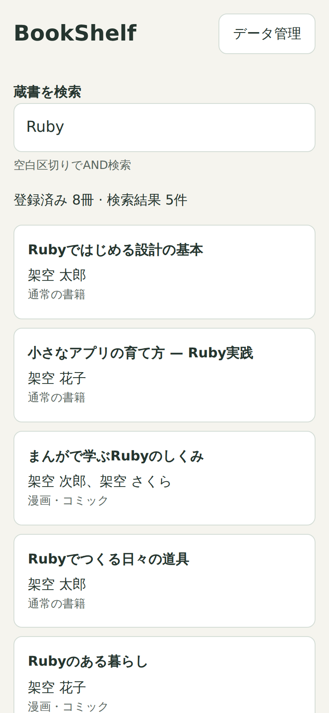
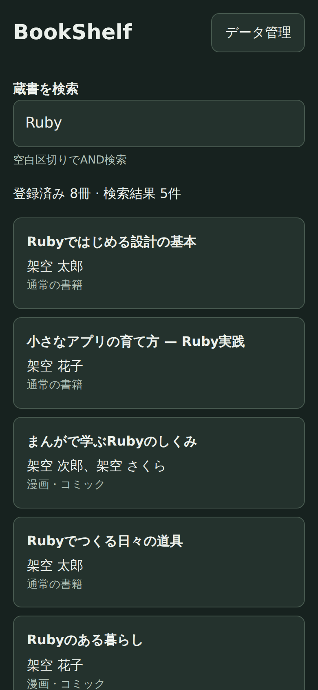

# BookShelf

Kindleからエクスポートした蔵書JSONを、Android端末内で検索する個人用PWAです。

## スクリーンショット

スマートフォンサイズ（390 × 844px）の検索画面です。Chromeのモバイル表示で撮影し、書籍・著者はすべて架空のデータを使用しています。

  
  

## 表示データ

- タイトル
- 著者
- ASIN
- 漫画・コミック判定フラグ
- 商品リンク

## 漫画のシリーズ表示

漫画は取り込み時にタイトルからシリーズを判定し、複数冊を所有するシリーズを共通タイトルでまとめます。一覧の登録済み表示には冊数とシリーズ数を表示します。シリーズ数には単独表示の本を含めません。

シリーズ詳細では、検索に一致した巻だけを巻数の大きい順で表示し、その中の最大巻を初期選択します。巻数不明の本は末尾にタイトル順で並び、全冊不明なら先頭を選択します。同じ画面で巻を切り替えられ、書影は選択中の1冊だけ読み込みます。

巻のボタンは算用数字、漢数字、ローマ数字、上下・前後編の順に表記を探し、`3`・`三`・`Ⅲ`・`上`などで短く表示します。同じ表示の重複は許容します。巻数を判定できない場合はシリーズ名を除いたタイトルを表示し、選択した本の正式タイトルは詳細欄に表示します。

判定は全角・半角、空白、波線・ハイフン類、巻数・特典表記を扱います。巻数の後ろにシリーズ名が再掲されるコミック版も判定します。本編・続編・外伝の名前の違いは保持しますが、タイトルに基づく推定のため、まとまらない本や誤判定が残ることがあります。

既存の蔵書にシリーズ表示を適用するには、JSONを再インポートしてください。

## 技術スタック

- HTML/CSS
- Vanilla JavaScript ES Modules
- IndexedDB
- Service Worker

ビルドと外部ランタイム依存はありません。

初回アクセスでアプリの静的ファイルをキャッシュします。
準備完了後はオフライン起動・検索・インポートができます。
書影の表示やAmazonリンクを開くには通信が必要です。

## Android Chromeでの使い方

1. 公開URLにオンラインでアクセスします。
2. Chromeメニューから「ホーム画面に追加」または「アプリをインストール」を選択します（表記は端末で異なります）。
3. 「データ管理」からJSONファイルを選択します。結果に取込冊数、不正・重複のスキップ件数が表示されます。
4. 更新時は新しいJSONを選び、既存データの全件置換します。

## 入力データの作成

BookShelf本体はAmazonへのログインや直接同期を行いません。
[Kindle蔵書エクスポートツール（ExportKindle.js）](https://gist.github.com/ledsun/21f83c4e48cf6fe51e4b6848e8671656) で、BookShelfに取り込む `books.json` を作成できます。

1. PCのChromeで [Kindle Cloud Reader](https://read.amazon.co.jp/) を開き、Amazonにログインします。
2. Chromeの開発者ツールを開き、Consoleタブを選択します。
3. Gistの `ExportKindle.js` の内容を確認し、Consoleで実行します。
4. 取得が完了すると `books.json` がダウンロードされます。
5. ファイルをAndroid端末へ移し、BookShelfの「データ管理」からインポートします。

## 保存データとプライバシー

認証Cookie、Amazonログイン情報、外部フォントは使用しません。

JSONファイルや蔵書一覧をインターネット上へアップロードしません。
解析サービスは使用しません。
入力データから以下のデータを抽出し、ブラウザのIndexedDBに保存します。

- タイトル
- 著者
- ASIN
- 検証済み書影URL
- 漫画フラグ
- 検索用文字列
- 漫画のシリーズ判定用キー・表示名・巻数

Service WorkerのCache Storageには静的アプリファイルのみ保存します。

詳細を開くと`coverImageUrl`の画像を読み込みます。画像リクエストに認証情報やRefererは付けません。

異なる端末・ブラウザへは再インポートが必要です。

## 開発者向け情報

ローカル起動・テスト、GitHub Pagesへのデプロイ、入力JSONの仕様は [CONTRIBUTING.md](CONTRIBUTING.md) を参照してください。
