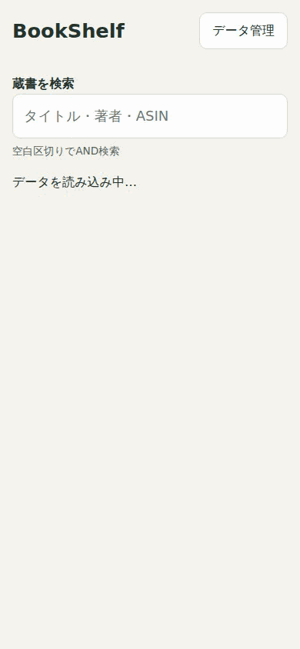

# BookShelf

[BookShelfを開く](https://ledsun.github.io/book-shelf/)

Kindleからエクスポートした蔵書JSONを、Android端末内で検索する個人用PWAです。

## 操作デモ

スマートフォンサイズ（390 × 844px）で、検索・書籍詳細・漫画の巻切り替えを紹介する動画です。蔵書・著者はすべて架空で、表紙もデモ用に自作しています。

[動画をダウンロード（WebM）](https://raw.githubusercontent.com/ledsun/book-shelf/main/docs/videos/bookshelf-demo.webm)してChromeなどで再生できます。

## 表示データ

- タイトル
- 著者
- ASIN
- 漫画・コミック判定フラグ
- 商品リンク

## 技術スタック

- HTML/CSS
- Vanilla JavaScript ES Modules
- IndexedDB
- Service Worker

ビルドと外部ランタイム依存はありません。

初回アクセスでアプリの静的ファイルをキャッシュします。
準備完了後はオフライン起動・検索・インポートができます。
書影の表示やAmazonリンクを開くには通信が必要です。

## Android Chromeでの使い方

1. 公開URLにオンラインでアクセスします。
2. Chromeメニューから「ホーム画面に追加」または「アプリをインストール」を選択します（表記は端末で異なります）。
3. 「データ管理」からJSONファイルを選択します。結果に取込冊数、不正・重複のスキップ件数が表示されます。
4. 更新時は新しいJSONを選び、既存データの全件置換します。

ファイル選択画面でGoogleドライブを選べる端末では、事前のダウンロードは不要です。直接連携を設定した場合は「ドライブのファイルを選ぶ」で取り込むと、次回から「前回のファイルから更新」を使えます。毎回Googleの認可を受け、アクセストークンは保存しません。設定手順は[開発者向け情報](CONTRIBUTING.md#googleドライブ連携の設定)を参照してください。

## 入力データの作成

BookShelf本体はAmazonへのログインや直接同期を行いません。
[Kindle蔵書エクスポートツール（ExportKindle.js）](https://gist.github.com/ledsun/21f83c4e48cf6fe51e4b6848e8671656) で、BookShelfに取り込む `books.json` を作成できます。

1. PCのChromeで [Kindle Cloud Reader](https://read.amazon.co.jp/) を開き、Amazonにログインします。
2. Chromeの開発者ツールを開き、Consoleタブを選択します。
3. Gistの `ExportKindle.js` の内容を確認し、Consoleで実行します。
4. 取得が完了すると `books.json` がダウンロードされます。
5. ファイルをAndroid端末へ移し、BookShelfの「データ管理」からインポートします。

## 保存データとプライバシー

BookShelfは認証Cookie、Amazonログイン情報、外部フォントを保存・使用しません。任意のGoogleドライブ直接連携ではGoogleの認可画面・ファイル選択画面を使用し、Google側のログイン状態が利用されます。

JSONファイルや蔵書一覧をインターネット上へアップロードしません。
解析サービスは使用しません。
入力データから以下のデータを抽出し、ブラウザのIndexedDBに保存します。

- タイトル
- 著者
- ASIN
- 検証済み書影URL
- 漫画フラグ
- 検索用文字列
- 漫画のシリーズ判定用キー・表示名・巻数

Googleドライブ直接連携では、前回のファイルID・名前を端末に保存します。アクセストークンは操作中だけメモリで使用し、永続保存しません。リフレッシュトークンは取得しません。

Service WorkerのCache Storageには静的アプリファイルのみ保存します。

詳細を開くと`coverImageUrl`の画像を読み込みます。画像リクエストに認証情報やRefererは付けません。

異なる端末・ブラウザへは再インポートが必要です。

## 開発者向け情報

ローカル起動・テスト、GitHub Pagesへのデプロイ、入力JSONの仕様は [CONTRIBUTING.md](CONTRIBUTING.md) を参照してください。
